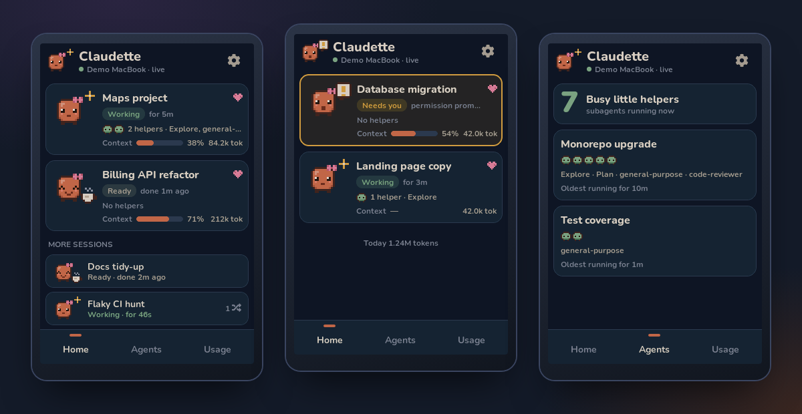

<p align="center"></p>

# Claudette

A tiny, cute desk display for [Claude Code](https://code.claude.com). It shows your favourite sessions, which ones
are **working**, which **need you**, how many subagents (her *little helpers*) are out, and how many tokens you've
used today. It runs on a small ESP32-S3 touchscreen that sits next to your keyboard, powered from any USB charger.

- **Local-first.** A small service on your Mac reads Claude Code's own status locally. No cloud, no API key.
- **Honest.** Unknown stays unknown. It never shows a made-up zero or a fake progress bar.
- **One UI, two runtimes.** The same LVGL C code runs on the device and in your browser.

**[▶ Try it in your browser](https://jgkinnear.github.io/claudette/)**: the real device UI, compiled to WebAssembly,
with demo data.

> Claudette is an unofficial hobby project. It is not affiliated with or endorsed by Anthropic.

---

## Build your own

### What you need

| | |
|---|---|
| **Display** | [Freenove ESP32-S3 Display, 4.0" (FNK0104S)](https://docs.freenove.com/projects/fnk0104/en/latest/): ST7796 320×480 touchscreen, 16 MB flash, 8 MB PSRAM |
| **Cable** | A USB-C *data* cable, needed once for flashing. Afterwards any USB charger will do. |
| **Computer** | A Mac with Claude Code installed, [Node.js 22+](https://nodejs.org) and [pnpm](https://pnpm.io) |
| **Tools** | [PlatformIO Core](https://platformio.org/install/cli) (`brew install platformio`) |

### 1. Get the code

```bash
git clone https://github.com/jgkinnear/claudette.git
cd claudette
pnpm install
```

### 2. Set up your Mac

```bash
pnpm setup:mac
```

This builds the companion service and runs `claudette setup`, which:

- checks for Node and the `claude` CLI, explains what it will read, and asks before changing anything;
- backs up `~/.claude/settings.json`, then **adds** a few small HTTP hooks (subagent start/stop, plus stop/end for tidying up) so it can count subagents. It never replaces your
  existing hooks or status line, and it can offer an optional status line for context % and plan limits;
- installs a LaunchAgent so the service starts at login (no `sudo`), and opens <http://localhost:3333>.

The service runs from this folder, so keep the clone where it is. `pnpm claudette status`, `doctor`, `logs` and
`uninstall` are there when you need them.

### 3. Flash the display

Plug the board in with the data cable, then:

```bash
pnpm flash
```

The first build downloads the ESP32 toolchain (a few hundred MB). If the port isn't found, hold **BOOT**, tap **RST**,
and run it again. `pnpm monitor` shows the serial log.

### 4. Join Wi-Fi and pair

1. The display shows a setup network (`Claudette-XXXX`) with a password and a QR code. Join it from your phone, and the
   setup page pops up. Choose your Wi-Fi.
2. The display finds your Mac on the network (via Bonjour). Tap it.
3. It shows a 6-digit code. Type it into <http://localhost:3333> on your Mac.

That's it. Unplug it from the Mac and power it from any USB charger. If your network blocks discovery (office or guest
Wi-Fi), enter your Mac's address manually in the setup page. Recovery, pins and troubleshooting are in
[apps/firmware/README.md](apps/firmware/README.md).

## Using it

- **What's listed:** every Claude Code session that's running right now, plus anything you've pinned. Anything that
  **needs you** (a permission prompt or a question) always comes first, with a pulsing amber card. Pinned sessions are
  next, in your order. They stay listed (as *Stopped*) even after Claude stops their process. Then come working
  sessions, then the rest, most recent first. Your conversation history isn't listed unless it's running or pinned.
- **List or tiles:** the button next to the gear switches between big cards plus a compact list, and a two-column
  grid of equal tiles. The display remembers your choice.
- **Tap** a session for details. **Long-press** it to pin it to the home screen. Pins only affect Claudette's display and
  never change Claude Code's own pinning.
- **Every session gets its own Claudette.** Body colour, headwear and extras are picked from a hash of the session,
  so a session always looks the same on the display and on the Mac page.
- **Swipe** or use the bottom bar to move between **Home**, **Agents** and **Usage**.
- On the Mac page you can pin, reorder and nickname sessions (nicknames are handy if real names are sensitive),
  approve or unpair displays, and see diagnostics.

| On screen | Meaning |
|---|---|
| **Working** (sage, bobbing, sparkles) | Claude is busy |
| **Needs you** (amber, "!" bubble) | Blocked on a permission prompt or a question |
| **Ready** (cup of tea) | Finished. Waiting for your next prompt |
| **Error** / **Stopped** | A background session failed or was stopped |
| **Sleeping** (Zzz) | The display can't reach your Mac. Last seen time shown |
| **Context** | How full a session's context window is (needs the optional status line) |
| **Tokens** | Work done this session: input + output + cache writes. Cache reads are shown separately |

## How it works

```text
Claude Code ──► claudette service (Node, on your Mac) ──Wi-Fi──► ESP32-S3 (LVGL)
  claude agents --json        normalised JSON snapshot              same LVGL UI ──► WebAssembly demo
  subagent hooks (HTTP)       paired-device tokens
  transcript usage (read-only)
```

The service polls `claude agents --json --all` for session states, receives `SubagentStart`/`SubagentStop` hooks,
and reads token usage from local transcripts (numbers only). The display polls a small authenticated JSON snapshot
every few seconds. Details: [docs/architecture.md](docs/architecture.md).

## Privacy & security

- Nothing leaves your network. The display only ever receives session names, states and counts. It never sees prompts,
  code, file paths or transcript contents.
- Displays must be paired with a code you type on the Mac. Tokens are stored hashed, and you can revoke them.
- The admin page and hook endpoints only answer requests from the Mac itself.
- Display traffic is plain HTTP on your LAN, so use it on networks you trust.

More detail is in [docs/privacy-security.md](docs/privacy-security.md).

## Hacking on it

```bash
pnpm dev:sim        # the device UI in your browser (needs Emscripten: brew install emscripten)
pnpm dev:service    # companion service with demo data, no Claude Code needed
pnpm dev:web        # the Mac settings page (proxies to the service)
pnpm test           # protocol + service tests
pnpm test:visual    # Playwright screenshots of every simulator scenario
```

See [docs/developing.md](docs/developing.md) for the repo layout and how the pieces fit.

## Limitations

- macOS only for the service, for now. Linux and Windows need a startup adapter and mDNS support.
- One Mac per display. One board is supported so far, but adding another is mostly a pin table
  (see the firmware README).
- Context % and plan limits only show up if you enable the optional Claudette status line.
- Firmware updates are over USB. Over-the-air updates aren't implemented.
- The token totals come from Claude Code's local transcripts, which aren't a stable public format. If they change,
  Claudette shows "unavailable" rather than wrong numbers.

## Credits

Original pixel art and code: MIT ([LICENSE](LICENSE)). Built with [LVGL](https://lvgl.io) (MIT),
[LovyanGFX](https://github.com/lovyan03/LovyanGFX) (FreeBSD), [jsmn](https://github.com/zserge/jsmn) (MIT) and
[zod](https://zod.dev) (MIT). Text uses [Nunito](https://github.com/googlefonts/nunito), and icons use Montserrat from LVGL,
both under the SIL Open Font License ([OFL.txt](packages/lvgl-ui/src/fonts/OFL.txt)).
